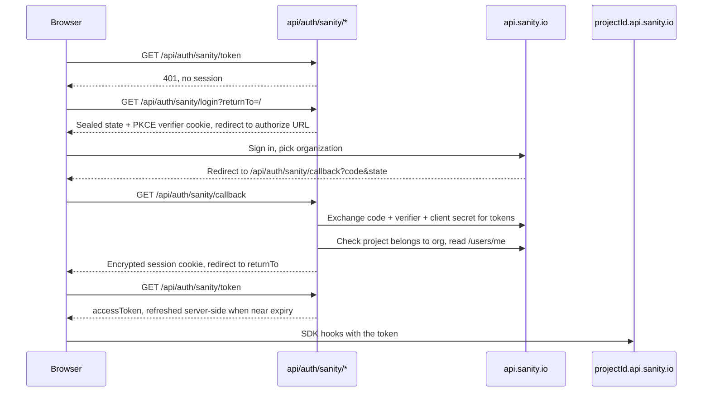

# Standalone Sanity App SDK app with Sanity OAuth, and an optional global API proxy

This template runs a [Sanity App SDK](https://www.sanity.io/docs/app-sdk) app on your own domain (for example Vercel) instead of inside the Sanity Dashboard. Users sign in with their own Sanity account through Sanity OAuth, and the app reads and edits content in one Sanity project as that user.

Sign-in is a confidential OAuth client (authorization code flow with PKCE) running in Vercel Functions. The access and refresh tokens live in an encrypted httpOnly cookie, and the browser only ever holds a short-lived access token, in memory. The OAuth implementation is ported from [demo-repositories/embedded-sdk](https://github.com/demo-repositories/embedded-sdk), a Next.js version of the same idea.

It also includes an optional Vercel Function that proxies the global Sanity API, so hooks such as `useProject`, `useProjects` and `useOrganizations` work from your domain.

You do not have to use this repository. The [step-by-step guide](#build-it-yourself-step-by-step) below explains each change, so you can apply it to an existing App SDK app.

Tested with `@sanity/sdk` and `@sanity/sdk-react` 3.12.0, `@sanity/client` 8.15.1, `sanity` 6.23.0, `iron-session` 9.1, Node 22.12+ and Vercel.

## Contents

- [What breaks by default on your own domain](#what-breaks-by-default-on-your-own-domain)
- [How sign-in works](#how-sign-in-works)
- [Quick start with this template](#quick-start-with-this-template)
- [Build it yourself, step by step](#build-it-yourself-step-by-step)
- [Optional: proxy for global API endpoints](#optional-proxy-for-global-api-endpoints)
- [Deploy to Vercel](#deploy-to-vercel)
- [Verify a deployment](#verify-a-deployment)
- [Limitations and security notes](#limitations-and-security-notes)
- [Files in this template](#files-in-this-template)

## What breaks by default on your own domain

The App SDK quickstart builds apps for the Sanity Dashboard. On `localhost` everything works, which hides the problems below. They show up only once the app is served from a real domain.

| Problem | Cause | Fix in this template |
|---|---|---|
| The app redirects to `sanity.io/welcome` after one second. | `SanityApp` redirects whenever the page is not on localhost and not inside the Dashboard. | Render `SDKProvider` instead of `SanityApp`. |
| Login never returns to your app. | The SDK's built-in login goes to `www.sanity.io/login`. That page only returns users to localhost and Sanity domains. | Sign in with Sanity OAuth instead, using redirect URIs registered on your own OAuth client. Pass the token to the SDK with `auth.token`, so the SDK never starts its own login. |
| After login: "Authentication Error". | The SDK's own login exchanges the session and loads the current user on the global host `api.sanity.io`, which sends no CORS headers for your domain. | The token exchange, the organization check and `/users/me` run on the server, in the callback function. |
| A browser-held token can list the user's whole account. | The SDK's standalone login stores its token in `localStorage`. | Tokens are sealed in an httpOnly cookie. The browser gets only the access token, kept in memory and fetched from `/api/auth/sanity/token`. The refresh token and client secret never leave the server. |
| `useProject`, `useProjects`, `useOrganizations`, `useUsers` and similar hooks fail with CORS errors. | These hooks call `api.sanity.io`, which sends no CORS headers for your domain and rejects requests whose `Origin` it does not allow. | Optional same-origin proxy (Vercel Function) that forwards these calls without the `Origin` header. |

Document and query hooks use the project host (`<projectId>.api.sanity.io`), which honors the project's CORS origins. Once sign-in works, they work on your domain without a proxy. You need the proxy only if you use global-API hooks.

## How sign-in works



## Quick start with this template

Requirements: Node 22.12 or later, pnpm, a Vercel account (for `vercel dev`), a Sanity project, its organization ID, and permission to create an OAuth client in that organization.

1. Install dependencies.

   ```bash
   pnpm install
   ```

2. Create an OAuth client for your Sanity organization, and register this redirect URI on it:

   ```
   http://localhost:3000/api/auth/sanity/callback
   ```

   Note the client ID and the client secret. The secret is shown once. If you cannot create OAuth clients, ask your organization admin or Sanity support.

3. Create `.env` from the example and fill it in. Use `.env`, not `.env.local`: `vercel dev` loads only `.env` for the functions. It is gitignored.

   ```bash
   cp .env.example .env
   ```

   - `SANITY_APP_PROJECT_ID`, `SANITY_APP_DATASET`: your project (sanity.io/manage) and dataset.
   - `SANITY_APP_ORGANIZATION_ID`: the organization that owns the project. Find it in sanity.io/manage or with `pnpm exec sanity organizations list`.
   - `SANITY_OAUTH_CLIENT_ID`, `SANITY_OAUTH_CLIENT_SECRET`: from step 2.
   - `SESSION_SECRET`: at least 32 random characters, for example `openssl rand -base64 48`.
   - The OAuth endpoint URLs and redirect URI defaults in `.env.example` are correct for local development.

4. Allow the dev origin in your project's CORS settings.

   ```bash
   pnpm exec sanity cors add http://localhost:3000 --project <projectId>
   ```

5. Start the dev server and open http://localhost:3000.

   ```bash
   pnpm dev
   ```

   `pnpm dev` runs `vercel dev`, which serves the functions in `api/` and runs `sanity dev` behind them (the `devCommand` in `vercel.json`). The first run asks you to log in to Vercel and link the directory to a Vercel project. `pnpm dev:app` runs `sanity dev` alone, which has no `/api` routes, so sign-in does not work there.

   You are redirected to sign in with Sanity. After signing in you see your name, a sign-out button, recent documents, and a "Global API hooks" panel. On localhost the proxy is off and the global hooks call `api.sanity.io` directly, because that host allows localhost.

6. Deploy: see [Deploy to Vercel](#deploy-to-vercel).

## Build it yourself, step by step

These steps take an App SDK app from Dashboard-only to standalone on your own domain. File references point to this template, so you can copy the code.

### 1. Start from an App SDK app

Use an existing app, or scaffold one:

```bash
npx sanity@latest init --template app-quickstart --typescript --package-manager pnpm
```

The quickstart writes `SanityApp` into `src/App.tsx` and an empty `projectId`/`dataset`. The steps below replace both.

Add `@sanity/client` as a direct dependency, at the version `@sanity/sdk` uses, plus `iron-session` for the session cookie. The server functions use both.

```bash
pnpm add @sanity/client iron-session
pnpm add -D @types/node
```

### 2. Configure the project, dataset and organization

`sanity build` and `sanity dev` replace `process.env.SANITY_APP_*` with literal values at build time. They read them from the shell and from `.env` files.

- Read them in one module. See `src/env.ts`. It declares `process` locally, so it does not depend on `@types/node`.
- Everything `SANITY_APP_*` that the browser code references ends up in the bundle. Never put a token or secret there.
- `sanity dev` refuses to start without `app.organizationId` in `sanity.cli.ts` ("Apps require an organization ID"). See `sanity.cli.ts`. The OAuth functions also read `SANITY_APP_ORGANIZATION_ID` at runtime.

### 3. Render `SDKProvider` instead of `SanityApp`

`SanityApp` redirects to `sanity.io/welcome` on any origin that is not localhost and not inside the Dashboard. `SDKProvider` provides the same SDK context without that redirect.

`SDKProvider` is exported from `@sanity/sdk-react` but marked `@internal`. The SDK's Authentication Guide and its `apps/standalone-react` example use it for standalone apps. Pin your SDK version and re-test on upgrades.

### 4. Create the OAuth client and register redirect URIs

Create an OAuth client in the organization that owns the project. Register one redirect URI per environment:

- `http://localhost:3000/api/auth/sanity/callback` for local development.
- `https://your-app.example.com/api/auth/sanity/callback` for production.

The redirect URI the app sends (`SANITY_OAUTH_REDIRECT_URI`) must match a registered URI exactly, including scheme, port and path.

### 5. Add the server functions

The OAuth code runs in Vercel Functions under `api/`. Shared modules live in `api/_lib/`. Vercel does not deploy files under a directory starting with `_` as functions. Nothing under `api/` is bundled into the browser.

- `api/_lib/env.ts` reads and validates the server-only variables at request time. A missing variable returns a 500 that names it. These variables must not use the `SANITY_APP_` prefix.
- `api/_lib/session.ts` configures iron-session. The whole session (access token, refresh token, expiry and `sanityUserId`) is sealed into an httpOnly cookie, so you don't need a session store. `chunk: true` splits it across several cookies when it is larger than the browser's per-cookie limit.
- `api/_lib/oauth.ts` implements the protocol:
  - `beginOauth` creates a random `state` and PKCE verifier, seals both (plus `returnTo`) into a 10-minute cookie, and redirects to the authorize URL with the S256 challenge.
  - Every authorize and token request includes `resource=urn:io.sanity:organization:<orgId>`, which scopes the tokens to your organization.
  - `exchangeCode` and `refreshTokens` post form data with the client ID and secret to the token endpoint.
  - `safeReturnTo` only accepts same-origin paths, which blocks open redirects.
- `api/_lib/sanity-user.ts` runs two checks with the new token:
  - `assertProjectAccess` reads `/projects/<projectId>` and confirms that the project's `organizationId` matches. Users who belong to several organizations choose one on the Sanity login screen, and a token for the wrong one is rejected here.
  - `fetchSanityUserId` reads `/users/me` and returns `sanityUserId`.

The four functions under `api/auth/sanity/`:

- **`login`**: `GET /api/auth/sanity/login?returnTo=/some/path` calls `beginOauth`.
- **`callback`**: Sanity redirects here with `code` and `state`. The function unseals the transaction cookie and compares `state` in constant time, exchanges the code, runs both checks (revoking the new tokens if either fails), writes the session cookie and redirects to `returnTo`.
- **`token`**: the only way the browser gets an access token. It returns `{accessToken, expiresAt}` from the session, refreshing first if the token is inside the refresh window. If refresh fails with a 4xx (other than 408 or 429), the session is destroyed and it returns 401. A network error or 5xx returns 503 and keeps the session.
- **`logout`**: revokes the token, destroys the session, and redirects to login.

### 6. Start the SDK with the session's token

`src/auth/SanityProvider.tsx` connects the server-side session to the SDK:

- It fetches the first token from `/api/auth/sanity/token`. A 401 sends the user to `/api/auth/sanity/login?returnTo=<current path>`.
- It builds the `SDKProvider` config once, with `projectId`, `dataset` and `auth: {token}`. With a token set, the SDK skips its own login flow, so it never redirects to `www.sanity.io/login`.
- When `rotate` is on, `TokenSync` re-fetches the token every 5 minutes, on window focus, and on a `sanity-token-refresh` event. It passes any new token to the existing SDK instance with `setAuthToken` (also `@internal`), so queries and listeners are not torn down.

```tsx
<SanityProvider tokenUrl="/api/auth/sanity/token" rotate>
  <YourApp />
</SanityProvider>
```

Sign out with a form that posts to the logout function:

```tsx
<form method="post" action="/api/auth/sanity/logout">
  <button type="submit">Sign out</button>
</form>
```

### 7. Add your origins to the project's CORS list

The SDK calls `<projectId>.api.sanity.io` straight from the browser, so add every origin the app is served from: local dev (`http://localhost:3000`), the production domain, and any preview domains you want to test.

```bash
pnpm exec sanity cors add https://your-app.example.com --project <projectId>
```

Or use sanity.io/manage → your project → API → CORS origins.

### 8. Build and deploy

`sanity build` writes a static single-page app to `dist/`. The auth functions need a host that runs them next to the static files, on the same origin. For Vercel, see [Deploy to Vercel](#deploy-to-vercel).

At this point sign-in, document reads and edits work on your domain. Add the proxy only if you need global-API hooks.

## Optional: proxy for global API endpoints

### When you need it

These SDK hooks call the global host `https://api.sanity.io` (SDK 3.12.0):

| Global request | Hooks |
|---|---|
| `/projects`, `/projects/:id` | `useProjects`, `useProject` |
| `/organizations`, `/organizations/:id` | `useOrganizations`, `useOrganization` |
| `/access/:type/:id/users`, `/access/:type/:id/users/:userId` | `useUsers`, `useUser` |
| `/access/:type/:id/user-permissions/me/check` | `useCheckPermissions` |
| `/applications`, `/installations` | `useApplication`, `useDeleteApplication`, `useInstallation` |

From your domain these fail in the browser. The user's token is valid for them, but `api.sanity.io` sends no CORS headers for your origin. It also rejects any request whose `Origin` header it does not allow, with 403 "CORS Origin not allowed".

The SDK's auth boundary also calls `GET /projects/:id` to check the organization. Without the proxy that call fails a few times and is ignored. The app keeps working.

### How it works

Three parts. Each is needed.

1. **A server-side proxy on your domain** (`api/sanity-proxy.ts`, a Vercel Function). It forwards the request to `https://api.sanity.io/<path>` with only `Authorization`, `Content-Type`, `Accept` and `Accept-Language`. It never forwards `Origin`, `Referer` or `Cookie`. It only proxies versioned paths (`v2025-02-19/...`), and the upstream host is fixed.
2. **A rewrite** (`vercel.json`): `/sanity-api/:__sanity_path*` → `/api/sanity-proxy?__sanity_path=:__sanity_path*`.
3. **A browser shim** (`src/globalApiProxy.ts`). It patches `fetch` and `XMLHttpRequest` and rewrites only `https://api.sanity.io/...` URLs to `/sanity-api/...` on your origin. Requests to `<projectId>.api.sanity.io` (data, listeners, mutations) are not touched. It is installed before `SDKProvider` mounts, only when `SANITY_APP_GLOBAL_API_PROXY=true`, and never on localhost.

### Enable it

1. Keep `api/sanity-proxy.ts`, the `/sanity-api` rewrite in `vercel.json`, and `src/globalApiProxy.ts`.
2. Build with `SANITY_APP_GLOBAL_API_PROXY=true`, for example in the Vercel project's environment variables.
3. Open the deployed app. The "Global API hooks" panel should say `proxy: on` and show your project name and counts.

### Why it is built this way

- **A function, not a plain rewrite.** Vercel external rewrites forward the browser's `Origin` header, and `api.sanity.io` rejects authenticated requests from unknown origins. The function drops `Origin`.
- **A fetch/XHR shim, not `auth.apiHost`.** The SDK uses one `apiHost` for every client. `@sanity/client` builds project URLs as `<projectId>.<apiHost host>`, so an `apiHost` with a path (`https://your-app.example.com/sanity-api`) would break every project-host request.
- **The parameter name `__sanity_path`.** Vercel appends a rewrite's named parameter to the destination query string. A parameter called `path` was forwarded to `api.sanity.io`, which rejected it with 400 "path is not allowed". The function removes `__sanity_path` before forwarding.
- **The proxy does not read the session.** The access token the SDK holds passes through in the `Authorization` header. The proxy never forwards the session cookie.

### Other hosts

The same design works on any host with server functions (Netlify Functions, Cloudflare Workers, your own server):

- Route a same-origin path to a function that calls `https://api.sanity.io/<path>`.
- Forward `Authorization` and the request body. Do not forward `Origin`.
- Point the browser shim at that path.

### Remove it

If you do not use global-API hooks:

1. Delete `api/sanity-proxy.ts` and `src/globalApiProxy.ts`.
2. Delete `src/GlobalApiCheck.tsx`, which exists only for diagnostics.
3. Remove the `/sanity-api` rewrite from `vercel.json`.
4. Remove the `installGlobalApiProxy` import and call from `src/App.tsx`.

## Deploy to Vercel

`vercel.json` sets `framework: null`, the install, build and dev commands, `outputDirectory: "dist"`, the proxy rewrite, and an SPA fallback to `index.html` that skips `/api/`. Files in `api/` deploy as functions, except `api/_lib/`.

1. Register the production redirect URI (`https://your-app.example.com/api/auth/sanity/callback`) on the OAuth client.
2. Add the production origin to the project's CORS list (step 7).
3. In the Vercel project settings, under Environment Variables, set everything from `.env.example`:
   - `SANITY_APP_PROJECT_ID`, `SANITY_APP_DATASET`, `SANITY_APP_ORGANIZATION_ID`, and optionally `SANITY_APP_GLOBAL_API_PROXY=true`. The build inlines these into the bundle, and the functions read them at runtime.
   - `SANITY_OAUTH_CLIENT_ID`, `SANITY_OAUTH_CLIENT_SECRET`, `SESSION_SECRET`, the three OAuth endpoint URLs, and `SANITY_OAUTH_REDIRECT_URI` set to the production callback. Mark the secrets as sensitive. Do not pass secrets with `--build-env`: they are only needed at runtime.
4. Deploy.

   ```bash
   npx vercel@latest deploy --prod
   ```

Notes:

- Serve over HTTPS. Cookies are marked `Secure` when `NODE_ENV=production`, so sign-in does not work over plain HTTP in production.
- Changing `SESSION_SECRET` signs everyone out.
- Use a current Vercel CLI (`npx vercel@latest`). Older global installs can fail on upload.
- Each Vercel preview deployment has its own origin. Sign-in works on a preview only if its callback URL is registered on the OAuth client, `SANITY_OAUTH_REDIRECT_URI` points at it, and its origin is in the project's CORS list. Previews also sit behind Vercel Authentication by default.

## Verify a deployment

1. Open the deployed URL in a private window. You should be redirected to the Sanity sign-in page.
2. Sign in and pick the organization that owns the project. You return to your domain, signed in.
3. Reload. You stay signed in. In the browser's storage panel, there is no token in `localStorage`. The `sanity_session` cookie is `HttpOnly`.
4. Recent documents load. In the network panel, data requests go to `<projectId>.api.sanity.io`.
5. Sign out. You are sent back through sign-in.
6. If the proxy is enabled, the "Global API hooks" panel shows `proxy: on` and real values. Global requests appear as `/sanity-api/...` on your origin, and responses carry `x-sanity-global-proxy: 1`.

To check the functions without a browser:

```bash
curl -i "https://your-app.example.com/api/auth/sanity/token"        # 401 without a session
curl -i "https://your-app.example.com/api/auth/sanity/login"        # 302 to the authorize URL
curl -i "https://your-app.example.com/sanity-api/v2025-02-19/users/me"  # proxy: 200 and {} without a token
```

## Limitations and security notes

- **One project per app.** The session and the organization check are for one project, set by `SANITY_APP_PROJECT_ID`.
- **The access token is in browser memory.** The refresh token and client secret never leave the server, and nothing is written to `localStorage`. But the access token the SDK holds can still list the user's organizations, projects and datasets through `api.sanity.io` until it expires. Keep third-party scripts to a minimum and use a strict Content Security Policy.
- **Token refresh is server-side.** The token function refreshes when the access token is within `SANITY_TOKEN_REFRESH_WINDOW_SECONDS` of expiry, and `SanityProvider` picks the new token up within 5 minutes, on focus, or on the `sanity-token-refresh` event.
- **Logout does not end the sanity.io login.** Revoking the token does not necessarily sign the user out of sanity.io, so the next sign-in may skip the login screen.
- **Local dev needs `vercel dev`.** `sanity dev` alone cannot run the auth functions.
- **Dashboard-only features do not work standalone.** Favorites, document history and `useFrameConnection` need the Dashboard frame. This is unrelated to hosting.
- **Not verified through the proxy.** PATCH and PUT, `useUsers`/`useUser`, `useDeleteApplication`, comments, agent actions, and cold-start latency. GET, POST and DELETE were tested through the same proxy design.
- **The proxy shim is always in the bundle.** `SANITY_APP_GLOBAL_API_PROXY` controls whether it is installed, not whether it is bundled.
- **Depends on SDK internals.** `SDKProvider` and `setAuthToken` are `@internal` in SDK 3.12.0. Re-test after SDK upgrades.

## Files in this template

| File | Purpose |
|---|---|
| `src/App.tsx` | Entry. Optionally installs the proxy shim, renders `SanityProvider` and the example view with a sign-out button. |
| `src/env.ts` | Reads the `SANITY_APP_*` build-time variables. |
| `src/auth/SanityProvider.tsx` | Fetches the access token, starts `SDKProvider` with it, rotates it, redirects to sign-in on 401. |
| `src/RecentDocuments.tsx` | Example data view (`useDocuments`, `useDocumentProjection`). Replace with your app. |
| `src/GlobalApiCheck.tsx` | Diagnostic panel for global-API hooks. Optional. |
| `src/globalApiProxy.ts` | Optional browser shim: `api.sanity.io` → `/sanity-api`. |
| `api/auth/sanity/login.ts` | Starts OAuth: sealed state and PKCE cookie, redirect to the authorize URL. |
| `api/auth/sanity/callback.ts` | Verifies state, exchanges the code, checks the organization, writes the session. |
| `api/auth/sanity/token.ts` | Returns the access token, refreshing it near expiry. |
| `api/auth/sanity/logout.ts` | Revokes the token, clears the session. |
| `api/_lib/*` | Shared server code: env, cookies, session, OAuth protocol, Sanity user checks. |
| `api/sanity-proxy.ts` | Optional Vercel Function: `/sanity-api` → `api.sanity.io`, without `Origin`. |
| `vercel.json` | Build and dev settings, proxy rewrite, SPA fallback. |
| `sanity.cli.ts` | App entry and `organizationId` for `sanity dev`. |
| `.env.example` | All variables, with notes. |
